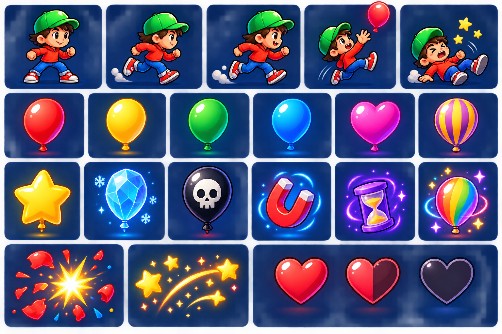

# Balloon Crazy V2 — Game Design Document

Status: proposed design  
Audience: owner, art, engineering, playtesters  
Relationship to V1: additive sequel direction; V1 remains the stable Android release

## 1. One-sentence pitch

Catch falling balloons, grow a wobbling stack, and carry it safely through short skill-based levels while chasing combos, objectives, and three-star scores.

## 2. Player promise

The player should understand the game in ten seconds:

1. Move the character under a balloon.
2. Catch it to grow the stack.
3. Bank a safe stack for points.
4. Avoid hazards and recover from mistakes.
5. Complete the objective and improve the score.

The original catch/hold/bank/miss loop is preserved. V2 adds purpose around that loop: levels, objectives, progression, and controlled variety.

## 3. Core game loop

```text
Choose level → read objective → catch balloons → manage stack risk
       ↑                                      ↓
  replay/result ← complete, miss, or fail ← bank / combo decision
```

### Moment-to-moment rules

- The player moves horizontally inside the playfield.
- A balloon follows a deterministic path downward with gentle horizontal sway.
- A successful catch adds the balloon to the held stack.
- The stack has a visible height and a stability value. Taller stacks sway more.
- The player may bank at the floor target to convert held balloons into score.
- A hazard contact or missed catch costs one life and clears the held stack.
- The level ends when its primary objective is complete, the timer expires, or all lives are lost.
- Every level can be replayed; no objective requires an online service.

## 4. Controls

### Primary control

- Touch-drag anywhere in the play area to move left/right.
- The character follows the horizontal touch position with a soft acceleration limit.

### Optional accessibility controls

- Two large left/right buttons for players who do not want drag control.
- Haptic feedback can be disabled.
- Reduced-motion option removes screen shake and shortens effects without changing rules.

The first level teaches only movement and catching. Banking, stack stability, and power-ups are introduced one at a time.

## 5. Sprite and effect roster

The concept board is a visual direction reference, not final production art:



### Player sprites

| ID | Purpose | Frames | Notes |
| --- | --- | ---: | --- |
| `player_ready` | idle/ready | 2 | Must remain recognisably the V1 character |
| `player_run` | movement | 6 | 3 left + 3 right, mirrored only if pixel quality holds |
| `player_catch` | successful catch | 4 | Arms raised; same hat, shirt, shoes, and proportions |
| `player_bank` | bank at floor | 4 | Short lift/celebration; cannot obscure HUD |
| `player_fall` | miss/failure | 6 | Use the V1 fall silhouette as the consistency anchor |
| `player_win` | level complete | 6 | Optional for V2 slice; reuse catch pose if omitted |

### Balloon sprites

| ID | Rule | Score | Collision |
| --- | --- | ---: | --- |
| `balloon_red/yellow/green/blue/pink` | normal catch | 10 | standard circle + string-safe inset |
| `balloon_gold` | rare bonus | 25 | standard; emits gold spark |
| `balloon_striped` | combo extender | 10 × current combo | standard; expires if not banked |
| `balloon_heart` | restores one life, max 4 | 0 | never spawns during terminal state |
| `balloon_crystal` | freezes sway briefly | 15 | standard; blue-white pulse |
| `balloon_skull` | hazard | 0 | hazard circle; clears stack and costs life |
| `balloon_rainbow` | power-up carrier | 20 | standard; grants selected power-up |

### Effects and UI icons

- `pop_burst`: 6-frame balloon disappearance; gameplay collision ends on frame 1.
- `combo_spark`: short, non-blocking streak behind the score label.
- `power_magnet`: attracts nearby normal balloons for 4 seconds.
- `power_shield`: absorbs one hazard/miss.
- `power_slow_time`: reduces balloon speed to 55% for 4 seconds.
- `power_rainbow_burst`: banks the current stack and grants a score multiplier.
- `life_full/half/empty`: three or four states depending on the selected difficulty.

### Sprite production constraints

- Target source size: 128 px logical character height and 64 px normal balloon diameter at the reference viewport.
- Export PNG with alpha; no baked UI text into gameplay sprites.
- Keep collision geometry separate from visible art.
- Every animated sheet needs a frame-count and frame-size manifest before engineering integration.
- The supplied concept images are references only; final assets must be newly authored or provenance-cleared.

## 6. Objectives

Each level has one primary objective and up to two optional star objectives. Only the primary objective is required to unlock the next level.

| Objective | Player behaviour it rewards |
| --- | --- |
| Catch `N` balloons | Basic accuracy and movement |
| Bank a stack of `N` | Risk management |
| Reach score `S` | Efficient catching and banking |
| Finish with `L` lives | Careful play |
| Perform a `C` combo | Rhythm and route planning |
| Collect `K` gold/crystal balloons | Target selection |
| Survive `T` seconds | Endurance |
| Avoid all hazards | Reading the field |

Objectives are displayed before play and remain visible as a compact progress bar during the level.

## 7. Scoring and progression

### Score

- Normal balloon: 10 points.
- Gold balloon: 25 points.
- Crystal balloon: 15 points and a temporary slow-sway bonus.
- Striped balloon: normal value multiplied by the active combo.
- Bank bonus: `held_count × held_count × 2`.
- Clean level bonus: 100 points when the player finishes with all lives.

### Combo

- A combo increments when catches occur within 1.5 seconds of one another.
- Banking preserves the combo and adds a bank bonus.
- Missing or waiting longer than 1.5 seconds resets the combo to 1.
- Combo labels are feedback only; they never pause or hide the board.

### Stars

- One star: primary objective complete.
- Two stars: primary objective plus first optional objective.
- Three stars: all objectives complete.

Stars unlock the next region and cosmetic character palettes. They do not create a paywall or alter collision fairness.

## 8. Difficulty model

Difficulty is tuned with four visible variables, not hidden randomness:

| Tier | Balloon speed | Spawn gap | Sway | Hazards |
| --- | ---: | ---: | ---: | --- |
| Tutorial | 0.75× | 1.20 s | low | none |
| Normal | 1.00× | 1.00 s | low | none/teaser |
| Fast | 1.15× | 0.90 s | medium | occasional skull |
| Hard | 1.30× | 0.78 s | medium | mixed hazards |
| Challenge | 1.50× | 0.65 s | high | frequent, patterned |

Difficulty may also add a second path or a taller target stack, but never changes the player hitbox without communicating it.

## 9. Level plan

The first V2 release should ship one region with twelve short levels. Each level takes 45–90 seconds and teaches one idea before combining it.

| Level | Name | Tier | Primary objective | New rule |
| ---: | --- | --- | --- | --- |
| 1 | First Lift | Tutorial | Catch 8 balloons | Movement and catch |
| 2 | Safe Stack | Tutorial | Bank a stack of 4 | Banking |
| 3 | Keep Moving | Normal | Score 180 | Faster spawn cadence |
| 4 | Gold Meadow | Normal | Catch 2 gold balloons | Gold bonus |
| 5 | Wobble Bridge | Normal | Bank a stack of 7 | Stack sway |
| 6 | Crystal Lake | Fast | Catch 12 balloons | Crystal slow-sway effect |
| 7 | Storm Warning | Fast | Finish with 3 lives | First patterned skull hazard |
| 8 | Combo Trail | Fast | Reach a ×5 combo | Combo timing |
| 9 | Rainbow Run | Hard | Collect 2 rainbow balloons | Power-up selection |
| 10 | Split Path | Hard | Score 700 | Two horizontal routes |
| 11 | Long Stack | Challenge | Bank a stack of 10 | High-risk banking |
| 12 | Balloon Summit | Challenge | Complete all objectives | Full ruleset finale |

### Region themes

1. **Meadow:** bright lake, low contrast, tutorial colours.
2. **Twilight:** warmer sky, stronger silhouettes, crystal and gold focus.
3. **Summit:** sunset/aurora palette, full hazard patterns, final challenge.

Backgrounds are gameplay support: the player and balloons always maintain contrast, and decorative scenery never receives collision.

## 10. Game modes

### Arcade (V2 slice)

Endless score chase with escalating speed. This is the first mode to implement and test.

### Adventure (V2 follow-up)

The twelve-level plan above, with stars and unlocks. No map animation is required for the first playable slice; a level list is sufficient.

### Retro (optional)

V1 presentation, fixed balloon set, no power-ups. This protects the original identity and gives a low-risk second mode.

### Multiplayer (not V2 slice)

Keep the menu slot only as a future placeholder. Do not design networking, matchmaking, accounts, or synchronization until a separate product decision exists.

## 11. Screen and UX plan

- **Home:** Play, Settings, Leaderboard, Stats, Skins; no balloon field behind menus.
- **Mode select:** Arcade is active; locked modes explain what is planned, not fake functionality.
- **Level select:** 12 level cards with difficulty, objective, and stars.
- **Briefing:** one objective sentence, one control hint, Continue.
- **Play:** pause, score, lives, objective progress, held stack; no overlap at the reference viewport.
- **Pause:** gameplay can remain visible but frozen; Resume and Exit are clear.
- **Results:** score, stars, objective results, Replay, Next Level.

## 12. Engineering plan

1. **Rules model:** add level definitions, objectives, modifiers, power-up timers, and deterministic seeds.
2. **Projection:** implement one level using existing V1 collision and coordinate mapping.
3. **UI flow:** home → mode → level → briefing → play → result.
4. **Feedback:** combo, objective progress, pop effects, and readable power-up states.
5. **Content:** author levels 1–3 first; do not build all twelve before playtesting.
6. **Art integration:** replace provisional sprite references only after the collision boxes and frame contracts are approved.

## 13. Acceptance criteria for the first V2 slice

- A new player can start Level 1 without instructions outside the game.
- Level 1 can be completed in under 90 seconds.
- The player can tell why a balloon was caught, missed, banked, or harmful.
- The held stack never hides the player or HUD.
- Pause/resume does not advance timers or spawn balloons.
- The same seed produces the same balloon sequence.
- Results show objective status and a replay path.
- One playtest session can identify at least one meaningful improvement without a crash or soft lock.

## 14. Deliberate non-goals

V2 is not a content-heavy live service. It will not add ads, purchases, accounts, online multiplayer, cloud saves, or procedural generation until the one-player loop is fun, readable, and stable.

