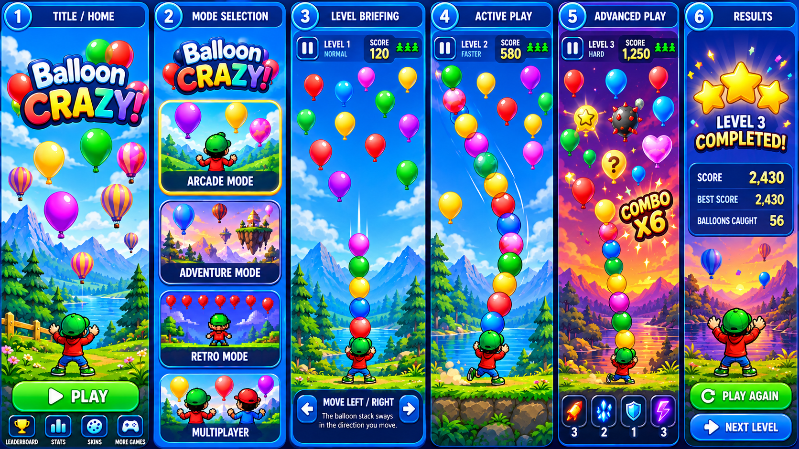

# Balloon Crazy Version 2 — Product Direction

Status: proposed  
Date: 2026-10-25  
Target: post-`1.0.0` exploration; no Version 1 gameplay or release scope changes

The detailed game design is in [Version 2 Game Design](version-2-game-design.md). This proposal remains the product boundary summary; the game-design document contains the playable rules, sprite roster, objectives, levels, difficulty curve, and acceptance criteria.

## Source direction

The supplied concept screens describe a larger, more colorful progression game while keeping the original Balloon Crazy fantasy: a small character catches a growing stack of balloons. The visual direction is polished mobile arcade: rounded blue panels, bright balloon colors, scenic backgrounds, large readable controls, and a clear score/lives HUD.

The reference screens are treated as product direction, not production assets. They require an art pass and a deliberate rights/provenance review before they can ship.

## Player story

The player starts at the Balloon Crazy home screen, chooses a mode, learns the movement rule, catches balloons, grows a stack, and tries to finish a level with a high score. Later levels introduce faster motion, taller stacks, combos, power-ups, and new scenery. A results screen gives a clear reason to replay or continue.

## Proposed player journey

1. **Home:** Balloon Crazy identity, Play, settings, and optional leaderboard/stats entry points.
2. **Mode select:** Arcade is the safest first mode; Adventure, Retro, and Multiplayer remain future mode slots until their rules are designed.
3. **Level briefing:** Show level number, difficulty, objective, and one short movement hint before play begins.
4. **Core play:** Preserve the Version 1 catch, hold, bank, miss, and fall loop, with a visible stack and responsive player movement.
5. **Mastery:** Add combos and power-ups only after the base loop remains readable and fair.
6. **Results:** Show score, performance feedback, replay, and next-level actions.

## Version 2 boundaries

### In scope for the first V2 slice

- A redesigned home screen and mode-select flow.
- Level metadata: level number, difficulty label, objective, and progression result.
- One Arcade mode that extends the existing catch-and-stack rules.
- A small, deterministic set of balloon colors and one or two power-ups.
- Combo feedback that is understandable without blocking play.
- Results and replay/next-level navigation.
- New art direction using original, reviewable assets.

### Explicitly out of scope until separately approved

- Online multiplayer or accounts.
- Purchases, ads, cloud saves, or telemetry.
- A large campaign, procedural level editor, or live-ops system.
- Replacing the original character without a consistency review.
- Shipping the supplied concept images as-is.

## Design constraints

- Touch controls must remain usable on small Android screens.
- The balloon stack must never hide the player, score, lives, or pause control.
- Gameplay must remain deterministic enough for tests and offline play.
- New effects must communicate state, not obscure collisions.
- The retro identity remains available as a visual reference even if V2 uses a modern presentation.

## Suggested V2 gates

1. **V2 discovery:** approve the mode, progression, and control rules.
2. **V2 visual prototype:** produce a home screen, one level, and one results screen using provisional art.
3. **V2 playable slice:** implement one complete Arcade level and replay loop.
4. **V2 content pass:** add levels, combos, and power-ups only after playtest evidence.
5. **V2 release decision:** choose `1.1.0` for an additive upgrade or `2.0.0` for a breaking redesign.

## Open decisions for the owner

- Should Adventure be a level map or simply a sequence of stages?
- Should the player move by touch-drag, left/right controls, or both?
- What does a power-up do, and how long does it last?
- Are lives still represented by the player icons, or should V2 use hearts?
- Is Multiplayer a real requirement or only a future menu placeholder?
